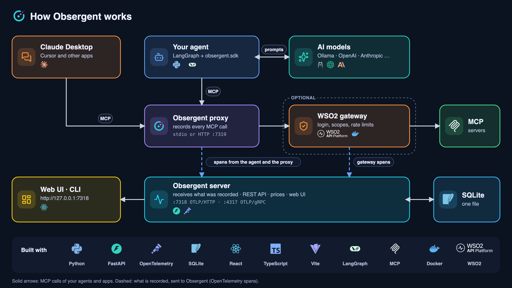
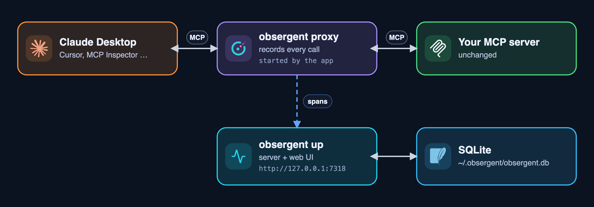
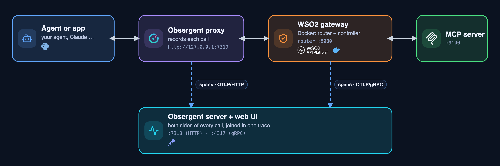

<p align="center">
  <picture>
    <source media="(prefers-color-scheme: dark)" srcset="docs/brand/obsergent-logo-light.svg">
    
  </picture>
</p>

# Obsergent

A **recorder and debugger for MCP agents**. It records everything an AI agent does (every LangGraph step, every model call and every MCP tool call), shows it in a web UI, and catches problems automatically.

It works with the **WSO2 API Platform MCP gateway** too: you see what the gateway decided for each call and where it spent its time. It runs on your laptop with one command and costs nothing.



> Contents

1. [Prerequisites](#1-prerequisites) · [Folder structure](#2-folder-structure)
2. [Start here: step by step](#3-start-here-step-by-step)
3. [Record your own agent](#4-record-your-own-agent) · [Claude Desktop and other apps](#5-record-claude-desktop-and-other-apps)
4. [Use it with the WSO2 API Platform gateway](#6-use-it-with-the-wso2-api-platform-mcp-gateway)
5. [The web UI](#7-the-web-ui) · [Monitoring tokens](#8-monitoring-tokens) · [Cost of model calls](#9-cost-of-model-calls)
6. [Obsergent vs Langfuse](#10-obsergent-vs-langfuse) · [Data model](#11-data-model) · [REST API](#12-rest-api)
7. [Configuration](#13-configuration) · [Tests](#14-tests)

---

## 1. Prerequisites

| You need               | Why                                                      | Get it                                         |
| ---------------------- | -------------------------------------------------------- | ---------------------------------------------- |
| **Python 3.11+** | Obsergent and the example agent                          | [python.org](https://www.python.org/downloads/) |
| **uv**           | creates the Python environment and installs the packages | [docs.astral.sh/uv](https://docs.astral.sh/uv/) |
| **Node.js 20+**  | only to build the web UI                                 | [nodejs.org](https://nodejs.org/)               |
| Ollama (optional)      | a free model on your own computer for the example agent  | [ollama.com](https://ollama.com/)               |

Install everything, from the repository root:

```bash
uv venv                                  # creates .venv
source .venv/bin/activate                # Windows: .venv\Scripts\activate
uv pip install -r requirements.txt       # Obsergent, the example agent, the tests and the tutorial examples
```

## 2. Folder structure

```
Obsergent/
├── src/obsergent/            # the Python package
│   ├── proxy/                # records MCP traffic: stdio and HTTP proxies, secret hiding, sessions
│   ├── sdk/                  # obsergent.sdk.init(): records your agent's steps, model calls and tokens
│   ├── ingest/               # turns incoming OpenTelemetry spans (and the gateway's) into Obsergent's records
│   ├── storage/              # the SQLite database and its automatic upgrades
│   ├── analysis/             # pure functions: questions, tokens, costs, agent graphs, findings, drift
│   ├── server/               # the web server: REST API, span receivers (HTTP, gRPC), price lists, the built UI
│   ├── cli.py                # the `obsergent` command
│   └── config.py             # reads config.yaml
├── ui/                       # the web UI (React + TypeScript + Vite); e2e/ holds the browser tests
├── examples/bookshop/        # an example agent and MCP server to try everything with
├── tutorial/                 # six step-by-step learning examples (OpenTelemetry, MCP, LangGraph, Jaeger…)
├── tests/                    # backend tests; fixtures/ holds real recorded traces
├── scripts/                  # helpers: gateway registration, test fixtures, benchmarks
├── docs/                     # guides: costs and tokens, Claude Desktop and other apps, WSO2
│   ├── diagrams/             # the pictures in this README and the guides (redraw with `make diagrams`)
│   └── brand/                # the Obsergent logo and the product logos used in the diagrams
├── config.yaml               # every port, address and path
├── .env.example              # the language model settings (copy to .env)
├── requirements.txt          # what `uv pip install -r requirements.txt` installs
└── Makefile                  # the commands you run (`make help` lists them)
```

There are no `__init__.py` files (namespace packages); modules are imported by their full path.

## 3. Start here: step by step

Run everything from the repository root (the [prerequisites](#1-prerequisites) installed).
The commands you run from this repository are in the [Makefile](Makefile) (`make help` lists them with one line each).
Every port, address and path is in [config.yaml](config.yaml) ([Configuration](#13-configuration)). The WSO2 gateway is a separate repository; its
commands are typed inside that repository ([WSO2 section](#6-use-it-with-the-wso2-api-platform-mcp-gateway)).

### Step 1: build the web UI and create .env (once)

After the [Prerequisites](#1-prerequisites) install:

```bash
make setup
```

`requirements.txt` installs this folder in editable mode (`-e`), so edits take effect at once. Everything in one command,
including the Python install: `make setup` (= `make install`, `make ui-install`, `make ui-build`, `make env`). Repeat `make ui-build` after changing anything in `ui/`. The Makefile uses
the environment that is already active, or `.venv` when none is, so you never need to activate it just to run `make`.

### Step 2: choose a language model

The example agent reads its model from `.env` (git-ignored, so keys stay on your machine; the template is
[.env.example](.env.example)). The default is **Ollama** (free, runs locally: `ollama pull qwen2.5:7b`). To use another
model change the `LLM_*` lines:

| You want                                                                           | `.env`                                                                                                                                  |
| ---------------------------------------------------------------------------------- | ----------------------------------------------------------------------------------------------------------------------------------------- |
| Ollama (default)                                                                   | `LLM_PROVIDER=ollama` `LLM_MODEL=qwen2.5:7b`                                                                                          |
| OpenAI                                                                             | `LLM_PROVIDER=openai` `LLM_MODEL=gpt-4o-mini` `OPENAI_API_KEY=...`                                                                  |
| Anthropic                                                                          | `LLM_PROVIDER=anthropic` `LLM_MODEL=claude-sonnet-4-5` `ANTHROPIC_API_KEY=...` (`uv pip install langchain-anthropic`)             |
| Groq / OpenRouter / Hugging Face / Together / Fireworks / DeepSeek / Mistral / xAI | `LLM_PROVIDER=groq` (or `openrouter`, `huggingface`, ...) `LLM_MODEL=<name>` and that service's key (`.env.example` lists each) |
| Your own server (vLLM, llama.cpp, LM Studio, LiteLLM)                              | `LLM_PROVIDER=openai_compatible` `LLM_BASE_URL=http://localhost:8000/v1` `LLM_MODEL=<name>`                                         |
| Anything else LangChain knows (Bedrock, Cohere, ...)                               | `LLM_PROVIDER=<its name>` `LLM_MODEL=<name>` after `uv pip install langchain-<provider>`                                            |

The model must support tool calling. Most hosted and open-source services speak the OpenAI API, so one client reaches all
of them (details in [examples/bookshop/llm.py](examples/bookshop/llm.py)).

### Step 3: record a real agent run

The UI starts empty: it shows only what your own agents, MCP servers and apps record. Everything is stored in one SQLite file (`storage.path` in `config.yaml`, by default `~/.obsergent/obsergent.db`).

```bash
make up                                  # terminal 1: the server and the UI at http://127.0.0.1:7318

# terminal 2 (environment active): the example agent. Type any question you like:
cd examples/bookshop
python agent.py "Do you have a Python book in stock, and how much is it?"
```

The question appears under **Conversations** within a second or two (no reload needed). Open it: the thread shows **you on the
right and the AI on the left** (each model reply and each tool with its input and result), the tokens and cost of every step, and
a summary; the **Timeline** tab shows every recorded event (switch to **Detailed** to copy a call as `curl`). The same data is
in the terminal:

```bash
make traces                                 # list the runs
make show ID=<first characters of a run id>  # one run as a tree
```

### Step 4 (optional): develop the UI with hot reload

```bash
make up                                    # terminal 1: the API
cd ui && npm run dev                       # terminal 2: http://localhost:5173, forwards /api to :7318
```

### If something does not start

| Symptom                                               | Fix                                                                                                                                                                         |
| ----------------------------------------------------- | --------------------------------------------------------------------------------------------------------------------------------------------------------------------------- |
| `make: … .venv/bin/obsergent: No such file`        | The environment is not installed yet: run the [Prerequisites](#1-prerequisites) commands (`make install` does the same)                                                    |
| The browser shows `{"detail":"Not Found"}` at `/` | The UI is not built: `make ui-build`                                                                                                                                      |
| `address already in use` on port 7318               | Another Obsergent server runs: `make stop` (or `make free-ports`), or change `server.port` in `config.yaml` (it applies to the server and every client)             |
| The UI says "server unreachable"                      | The server is not running: `make up` (or it uses another port than the UI's dev proxy: `OBSERGENT_API=http://127.0.0.1:PORT npm run dev`)                               |
| No runs appear                                        | The agent and the server must use the same `config.yaml` (`storage.path`, `server.port`); `make up` prints the database it uses; `make config` shows all settings |

---

## 4. Record your own agent

Three lines in your agent (see [examples/bookshop/agent.py](examples/bookshop/agent.py)):

```python
from obsergent.sdk import setup as at
provider = at.init("my-agent")                                         # spans -> Obsergent; LangGraph auto-traced
servers = {"x": at.proxy_server("x", [sys.executable, "server.py"])}   # start the MCP server through the proxy
at.trace_tool_calls(session)                                           # tool calls carry the trace id ...
# ... run the agent ... then: provider.shutdown()                      # send the last batch of spans
```

With `at.init(...)` Obsergent records, besides the MCP traffic, every **model call** of a LangGraph/LangChain agent: the
model, provider and parameters, the messages in and out, the **tool calls the model asked for**, token counts and latency,
and links each requested tool call to the real MCP call (and the gateway's decision, if there is one). Other frameworks:
`at.init("x", instrument=["openai"])` or `["anthropic"]` (`uv pip install "obsergent[openai]"`); anything emitting
OpenTelemetry GenAI attributes is understood too. Group runs with
`with at.context(session_id="chat-42", user_id="alice"): ...`. Tokens and costs are shown too
([Monitoring tokens](#8-monitoring-tokens)). Not included (Langfuse has them): scores, prompt management, datasets, evaluations.

## 5. Record Claude Desktop and other apps

Apps you did not write and cannot modify (Claude Desktop, Cursor, MCP Inspector) send no trace id, so Obsergent records them through its **proxy**: you change one entry in the app's config so it starts Obsergent's proxy instead of the server.
Their calls are grouped by **session** (one proxy process) in the UI.



**Claude Desktop, step by step** (details and troubleshooting: [docs/closed-apps.md](docs/closed-apps.md)):

1. **Start Obsergent first**: `make up`. If it is not running while you use Claude, the calls still work but **nothing is recorded**.
2. Claude Desktop → Settings → Developer → **Edit Config**, and add this entry (absolute paths; replace the prefix with yours):
   ```json
   "mcpServers": {
     "bookshop": {
       "command": "/Users/you/Obsergent/.venv/bin/obsergent",
       "args": ["proxy", "--name", "bookshop", "--",
                "/Users/you/Obsergent/.venv/bin/python",
                "/Users/you/Obsergent/examples/bookshop/bookshop_server.py"]
     }
   }
   ```
3. **Quit Claude Desktop completely (⌘Q) and reopen it.** Settings → Developer should show `bookshop` as running.
4. Ask Claude: *"Search the bookshop for Python books and tell me the price of the first one."* Approve the tool use.
5. Open http://127.0.0.1:7318 → **App activity** → the newest session: every call Claude made, with arguments and results.
   (Terminal: `make sessions`, `make traces`.)

---

## 6. Use it with the WSO2 API Platform MCP gateway

The WSO2 API Platform gateway (Docker; controller + Envoy router) can sit in front of MCP servers and enforce authentication, per-tool scopes, allow/deny lists and rate limits. Obsergent shows both sides of each call: what the agent saw, and what the gateway did. Full guide: [docs/wso2-integration.md](docs/wso2-integration.md). The registration and telemetry settings were **verified end to end** against gateway 1.2.1.



You need Docker. Commands marked **[gateway repo]** are typed inside the WSO2 repository; all the others (`make ...`) are run in
**this, the Obsergent repository** (environment active). Use one terminal per long-running command. The gateway's addresses and the MCP
server's name and path are in `config.yaml` (`gateway:` section).

**1. Get the WSO2 API Platform (once), first:**

```bash
git clone https://github.com/wso2/api-platform.git
cd api-platform/gateway                       # [gateway repo] the commands marked so are typed here
./scripts/setup.sh                            # [gateway repo] certificates, key, admin password: printed ONCE, copy it
```

**2. Let the gateway send its traces to Obsergent (once).** [gateway repo] Append this to `configs/config.toml`
(`4317` is `server.grpc_port` in this repository's `config.yaml`):

```toml
[tracing]
enabled = true
endpoint = "host.docker.internal:4317"        # Obsergent's gRPC receiver, seen from inside Docker
insecure = true
service_version = "1.0.0"
batch_timeout = "1s"
max_export_batch_size = 512
sampling_rate = 1.0
```

**3. Start everything, in this order:**

```bash
docker compose up                             # [gateway repo] the gateway: controller :9090, router :8080 (-d = in the background)
```

```bash
export WSO2AP_GW_PASSWORD='<password from setup.sh>'   # once per terminal; needed to register the MCP server in the gateway
make start                                             # [this repo] everything below, detached: you keep the same terminal
```

`make start` runs these, each in the background (`make status` shows them, `make logs` follows their output, `make stop` stops
them; logs are in `.run/`). You can also run them one by one: `make up-grpc-bg` (Obsergent + UI + the gateway's gRPC trace
receiver), `make mcp-http-bg` (the MCP server the gateway protects), `make register` (one REST call that registers it in the
gateway), `make proxy-bg` (Obsergent's recording proxy in front of the gateway). Each frees its port first if an older copy still
holds it. Without `-bg`, `make up-grpc`, `make mcp-http` and `make proxy` run in the foreground (one terminal each).

**4. Send traffic.** Your agent, with a question you type (the model comes from `.env`, [Step 2](#step-2-choose-a-language-model)):

```bash
cd examples/bookshop
MCP_URL=http://127.0.0.1:7319/mcp/wso2 python agent.py "Do you have a Python book in stock, and how much is it?"
```

or plain test calls without a model: `make traffic`. `make register-deny` makes the gateway refuse `get_price_and_stock`
(mcp-acl-list policy); `make register` updates the proxy back (not re-checked that the refusal disappears).

**Stop everything and start from scratch:**

```bash
make stop                                     # [this repo] stops what make start started
docker compose down                           # [gateway repo] stops the gateway (`down -v` also forgets the registered MCP proxy)
make reset-db                                 # EMPTIES Obsergent's database; stop Obsergent first (make stop)
```

Open **http://127.0.0.1:7318**: **Conversations** and **Gateway guard** show the calls and the gateway's decisions. To point your own
agent at it, use `http://127.0.0.1:7319/mcp/wso2` (its `Authorization` header is forwarded and never stored).

---

## 7. The web UI

Served by `make up` at `http://127.0.0.1:7318` (built from [ui/](ui/): React, TypeScript, Vite).

## 8. Monitoring tokens

Tokens are the pieces of text a model reads (**tokens in**: instructions, your question, the chat so far, tool results and tool
descriptions) and writes (**tokens out**: answers and tool requests); providers bill by them. They are counted by the model provider
and recorded from its response by `obsergent.sdk.init()`; the whole procedure, with a real Ollama example, is in
[docs/costs.md](docs/costs.md#tokens-what-they-are-and-how-obsergent-collects-them). Obsergent shows them everywhere a model appears:

* **Overview:** the Tokens tile (with the change from the period before) and the tokens of each question when you hover the chart.
* **Conversations:** the tokens of each step. Model replies are exact; your message and tool results are marked "≈" because
  they have no count of their own (they become part of the next model call's input), so they are estimated from their length.
* **Usage & cost → Tokens:** totals, a trend by model, where the tokens went, the **hidden overhead** (tool descriptions sent
  with every model call), prompts that use more than 80 % of the model's context window, and **heavy questions** (5 times your
  usual, or above `usage.question_token_alert`).
* **Models:** a trend line per model, and "you used 158k in + 11k out = $0.030" next to the price.
* **A daily budget (optional):** set `usage.daily_token_budget` in `config.yaml` (or `OBSERGENT_TOKEN_BUDGET`). From
  `usage.warn_at_percent` (80 %) the Overview shows a ring and a warning, and **Things to check** lists it.
* **Terminal:** `make usage` (`make usage HOURS=168` for a week) prints totals, by model, the heaviest questions and the budget.

## 9. Cost of model calls

Obsergent shows what each model call, conversation and model cost, in two kinds:

* **Exact.** OpenRouter and xAI send the amount they charged with every response. Obsergent reads it from the recorded response
  and shows it with an **exact** tag. (Other providers, such as OpenAI, Anthropic and Groq, send only token counts, so no exact cost exists.)
* **Estimated.** Token counts times the model's price. Prices are downloaded by Obsergent itself from public price
  lists (models.dev, OpenRouter, Hugging Face, LiteLLM) and compared with each other; nothing is typed in by hand. The formula
  covers cached input, reasoning, audio, long prompts, batch/flex/priority tiers, one-hour cache writes, web searches and
  US-only inference (details in [docs/costs.md](docs/costs.md)).

Models on your own computer (Ollama, LM Studio) are free; a model with no known price shows "no price" and is left out of totals.
Costs are calculated each time they are shown, with the price that was valid when the call was made (`pricing.reprice: now` uses
today's). **When prices update:** the live lists (OpenRouter, Hugging Face) every 30 minutes, the community lists (models.dev,
LiteLLM) every 2 hours, while Obsergent runs, plus when you press **Check now** or run `make prices`. The **Usage & cost** page says when
prices were last checked and when one changed.

**The one outbound call.** To get prices, Obsergent downloads those public files (plain GET requests; nothing about your
data is sent). Turn it off with `pricing.auto_refresh: false` in `config.yaml`, or all costs with `pricing.enabled: false`.

## 10. Obsergent vs Langfuse

They overlap (both store traces) but aim at different things; the same OpenTelemetry data can feed both. Obsergent does
**not** replace Langfuse.

|                                         | Langfuse                                                   | Obsergent                                                                                                             |
| --------------------------------------- | ---------------------------------------------------------- | --------------------------------------------------------------------------------------------------------------------- |
| Main subject                            | LLM generations and traces: prompts, completions, cost     | MCP tool calls and the traffic between client, gateway and server                                                     |
| Recording MCP                           | needs instrumentation in both client and server            | a **proxy** records it with no code change (Claude Desktop, Cursor, any language)                               |
| Calls inside your agent                 | yes: generations, tokens, cost, prompts, scores            | yes: model calls, tokens, conversation, and each tool call **linked to the real MCP call and gateway decision** |
| Apps you can't modify                   | not applicable                                             | **sessions** group everything such an app did                                                                   |
| Tool-description tampering              | not a feature                                              | **drift detection**, plus gateway-vs-upstream comparison                                                        |
| API gateway view                        | none                                                       | **WSO2 gateway**: decisions, refused calls, time inside the gateway, access-policy suggestions                  |
| Security findings, agent smells         | not its focus / build your own                             | built in                                                                                                              |
| Setup                                   | several services (or the cloud)                            | `pip install` + one process + one SQLite file, localhost only                                                       |
| **Cost**                          | cost dashboards                                            | an estimate per call, conversation and model, from prices that update themselves                                      |
| **Not in Obsergent (on purpose)** | prompt management, evaluations, datasets, scores, accounts |                                                                                                                       |

---

## 11. Data model

Everything is a `Span` ([models.py](src/obsergent/models.py)). SQLite (`storage.path` in `config.yaml`), schema versioned
with `PRAGMA user_version` (old files upgrade themselves):

| Object             | Kind  | Holds                                                                                                             |
| ------------------ | ----- | ----------------------------------------------------------------------------------------------------------------- |
| `spans`          | table | one row per span; `attributes` and `events` are JSON                                                          |
| `traces`         | view  | one row per run: duration, spans, tool calls, errors, services, models, tokens, servers, tools, gateway decisions |
| `sessions`       | view  | one row per proxy process                                                                                         |
| `tool_snapshots` | table | every distinct `tools/list` result per MCP server                                                               |
| `finding_acks`   | table | findings you dismissed                                                                                            |

Attribute names follow OpenTelemetry (`mcp.method.name`, `gen_ai.tool.name`...). Ours: `mcp.server.name`, `mcp.tools`,
`obsergent.session.id`, `obsergent.layer` (`gateway` for the gateway's spans), `gateway.decision`, `gateway.activity_id`,
`gateway.phase`, `gateway.latency_ms`, `obsergent.caller.*`.

## 12. REST API

The server (`make up`) serves it at `http://<server.host>:<server.port>` (default `http://127.0.0.1:7318`).

| Endpoint                                                                                                   | Purpose                                                                                                     |
| ---------------------------------------------------------------------------------------------------------- | ----------------------------------------------------------------------------------------------------------- |
| `POST /v1/traces`                                                                                        | OTLP/HTTP receiver: protobuf or JSON (gzip ok)                                                              |
| `GET /api/traces`                                                                                        | runs; filters `errors_only, tool, server, model, decision, q, session_id, since, until, before_ns, limit` |
| `GET /api/traces/{id}` · `/generations` · `/conversation`                                          | one run: spans + smells · model calls · the chat with tool calls linked to MCP calls                      |
| `GET /api/diff?a=&b=`                                                                                    | two runs and their first divergence                                                                         |
| `GET /api/stats/overview` · `/api/tools` · `/api/topology?expand=`                                 | dashboards (discussions, tools, latest questions, peaks), per-tool stats, the layered map                   |
| `GET /api/queries` · `/api/queries/timeline` · `/api/queries/{id}`                                 | the questions asked (steps, human/AI messages, tokens), the chart data, one question's thread with tokens   |
| `GET /api/models?hours=`                                                                                 | one entry per model: tokens and their trend, usage, cost, speed, price and what it can do                   |
| `GET /api/agents` · `/api/agents/{name}/graph`                                                        | agents and the nodes and edges of how each works                                                            |
| `GET /api/mcps`                                                                                          | MCP servers with their tools, inputs, usage and tool-list changes                                           |
| `GET /api/sessions` · `/{id}/traces` · `/{id}/timeline`                                            | proxy sessions                                                                                              |
| `GET /api/servers` · `/{name}/snapshots` · `/{name}/diff` · `/compare?a=&b=`                    | tool lists, drift, version diff, server vs server                                                           |
| `GET /api/findings` · `POST                                                                             | DELETE /api/findings/{id}/ack`                                                                              |
| `GET /api/gateway/summary` · `/api/gateway/calls/{activity_id}` · `/api/policy/suggestion?server=` | the gateway view, one call, the policy suggestion                                                           |
| `GET /api/spending` · `/api/prices` · `POST /api/prices/refresh`                                   | cost by model, tool and over time; the price lists' status; check prices now                                |
| `GET /api/usage?hours=&buckets=`                                                                         | tokens: totals, over time by model, by model/agent/tool/question, overhead, near the limit, budget, heavy   |
| `GET /api/version`                                                                                       | changes whenever something new is stored (the UI polls it every second to update at once)                   |
| `GET /health`                                                                                            | liveness                                                                                                    |

The HTTP recording proxy (`make proxy`, port `proxy.port`, default 7319) serves `POST|GET|DELETE /mcp/{name}`.

## 13. Configuration

| `config.yaml` key                            | Default                                                        | Environment override                    | Meaning                                                                                      |
| ---------------------------------------------- | -------------------------------------------------------------- | --------------------------------------- | -------------------------------------------------------------------------------------------- |
| `server.host` / `server.port`              | `127.0.0.1` / `7318`                                       | `OBSERGENT_HOST` / `OBSERGENT_PORT` | where the server (`make up`) listens (UI, REST API, OTLP/HTTP)                             |
| `server.grpc_port`                           | `4317`                                                       | `OBSERGENT_GRPC_PORT`                 | the OTLP/gRPC receiver (`make up-grpc`)                                                    |
| `server.endpoint`                            | empty = `http://<host>:<port>`                               | `OBSERGENT_ENDPOINT`                  | where the SDK and proxies send spans                                                         |
| `storage.path`                               | `~/.obsergent/obsergent.db`                                  | `OBSERGENT_DB`                        | the SQLite file                                                                              |
| `recording.max_attr_chars`                   | `4000`                                                       | `OBSERGENT_MAX_ATTR_CHARS`            | longest value kept in one span attribute                                                     |
| `proxy.host` / `proxy.port`                | `127.0.0.1` / `7319`                                       | `OBSERGENT_PROXY_PORT`                | the HTTP recording proxy (`make proxy`)                                                    |
| `gateway.router`                             | `http://localhost:8080`                                      | `GATEWAY_ROUTER`                      | where MCP traffic enters the WSO2 gateway                                                    |
| `gateway.controller`                         | `http://localhost:9090/api/management/v1`                    | `GATEWAY_CONTROLLER`                  | the gateway's management API (`make register`)                                             |
| `gateway.username`                           | `admin`                                                      | `WSO2AP_GW_USERNAME`                  | gateway admin user                                                                           |
| `gateway.mcp_name` / `gateway.mcp_context` | `wso2` / `/bookshop`                                       |                                         | the proxy's name in Obsergent, the MCP server's path in the gateway                          |
| `bookshop.http_port`                         | `9100`                                                       | `BOOKSHOP_PORT`                       | the example MCP server over HTTP                                                             |
| `pricing.enabled`                            | `true`                                                       | `OBSERGENT_PRICING`                   | calculate costs at all                                                                       |
| `pricing.auto_refresh`                       | `true`                                                       | `OBSERGENT_PRICING_AUTO_REFRESH`      | download prices automatically (the one outbound call)                                        |
| `pricing.refresh_minutes`                    | `openrouter 30, huggingface 30, models_dev 120, litellm 120` |                                         | how often each price list is checked (a check that finds nothing new is a few hundred bytes) |
| `pricing.exact_from_provider`                | `true`                                                       | `OBSERGENT_PRICING_EXACT`             | use the cost OpenRouter and xAI send with every response instead of an estimate              |
| `pricing.credits_per_usd`                    | `1`                                                          |                                         | OpenRouter reports credits; credits per US dollar                                            |
| `pricing.reprice`                            | `call_time`                                                  | `OBSERGENT_PRICING_REPRICE`           | `call_time` = the price valid when the call was made, `now` = today's price              |
| `pricing.sources`                            | four public lists                                              |                                         | where prices are downloaded from                                                             |
| `pricing.local_providers`                    | `[ollama, lmstudio, llamacpp, vllm]`                         |                                         | run on your machine: cost $0                                                                 |
| `pricing.overrides`                          | `{}`                                                         |                                         | optional prices typed by hand (normally empty)                                               |
| `usage.daily_token_budget`                   | `0` (no budget)                                              | `OBSERGENT_TOKEN_BUDGET`              | tokens allowed per day; warnings on the Overview and in Things to check                      |
| `usage.warn_at_percent`                      | `80`                                                         |                                         | from which share of the budget the warning starts                                            |
| `usage.question_token_alert`                 | `0` (5x the usual)                                           |                                         | flag a single question above this many tokens                                                |

Secrets are never in `config.yaml`: the gateway password is the environment variable `WSO2AP_GW_PASSWORD`, and the language
model's settings and API keys are in `.env` (copied from `.env.example`, git-ignored; [Step 2](#step-2-choose-a-language-model)). The UI's dev server
uses `OBSERGENT_API` (default `http://127.0.0.1:7318`) to find the API.

## 14. Tests

```bash
make lint          # ruff
make test          # backend: unit + integration (real proxy, real MCP server, gRPC receiver)
make test-ui       # UI: type check, unit tests, production build
make test-e2e      # browser tests: build the UI, load a throw-away test database (ui/e2e), start the server
make check         # lint + test + test-ui
```

Real-data fixtures in `tests/fixtures/`: an Ollama agent run, four recorded questions of the bookshop agent (`agent_graph_run.json`), a WSO2 API Manager 4.7 trace and a WSO2 API Platform
gateway trace (refresh them with `scripts/export_trace_fixture.py`). `tests/test_agent_e2e.py` runs the example agent with a
real local model and is skipped when Ollama is not running. Speed: `python scripts/bench.py` (ingest rate, proxy overhead per call).
