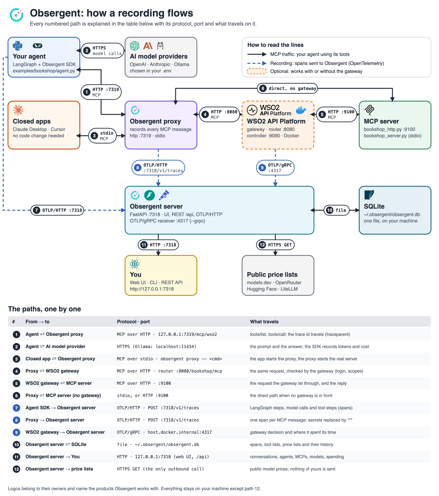

# AgentTrace

A free, local-first **flight recorder and debugger for MCP agents**. It records everything an AI agent does (every
LangGraph step, every model call and every MCP tool call), shows it in a web UI, and catches problems automatically.
It works with the **WSO2 API Platform MCP gateway** too: you see what the gateway decided for each call and where it
spent its time. It runs on your laptop with one command and costs nothing.



> **Status:** recorder, HTTP and stdio proxies, sessions, tool-list drift detection, agent-side model recording,
> WSO2 API Platform gateway integration, REST API, CLI and the **React web UI** are implemented and tested.
> Not built yet: replay/fork of a run, a policy/blocking mode, server mode with ClickHouse/PostgreSQL/Redis (see the
> build plan, [docs/AgentTrace_Build_Plan.pdf](docs/AgentTrace_Build_Plan.pdf)). The step-by-step learning examples
> are in [tutorial/](tutorial/).

## Contents

1. [Start here: step by step](#1-start-here-step-by-step)
2. [Record your own agent](#2-record-your-own-agent) · [Claude Desktop and other apps](#3-record-claude-desktop-and-other-apps)
3. [Use it with the WSO2 API Platform gateway](#4-use-it-with-the-wso2-api-platform-mcp-gateway)
4. [The web UI](#5-the-web-ui)
5. [AgentTrace vs Langfuse](#6-agenttrace-vs-langfuse)
6. [How it works](#7-how-it-works) · [Data model](#8-data-model) · [REST API](#9-rest-api) · [CLI](#10-cli) · [Configuration](#11-configuration)
7. [Analysis](#12-analysis-smells-drift-findings) · [Folder structure](#13-folder-structure) · [Tests](#14-tests) · [Limits](#15-design-decisions-and-limits)

---

## 1. Start here: step by step

You need **Python 3.11+**, [uv](https://docs.astral.sh/uv/) (for the Python environment) and **Node.js 20+** (only to build the
web UI). Run everything from the repository root.

The commands you run from this repository are in the [Makefile](Makefile) (`make help` lists them with one line each).
Every port, address and path is in [config.yaml](config.yaml) (section 11). The WSO2 gateway is a separate repository; its
commands are typed inside that repository (section 4).

### Step 1: install and build (once)

```bash
uv venv                                              # creates .venv (skip if you already have an environment active)
source .venv/bin/activate                            # skip if an environment is already active; Windows: .venv\Scripts\activate
uv pip install -e ".[dev,langchain,examples,grpc]"   # AgentTrace + the example agent, the tests and the gRPC receiver
cd ui && npm install && npm run build && cd ..       # the web UI, built into src/agenttrace/server/static/
cp .env.example .env                                 # the language model settings (next step)
```

`-e` links your source, so edits take effect at once. The same in one command: `make setup` (= `make install`,
`make ui-install`, `make ui-build`, `make env`). Repeat `make ui-build` after changing anything in `ui/`. The Makefile uses
the environment that is already active, or `.venv` when none is, so you never need to activate it just to run `make`.

### Step 2: choose a language model

The example agent reads its model from `.env` (git-ignored, so keys stay on your machine; the template is
[.env.example](.env.example)). The default is **Ollama** (free, runs locally: `ollama pull qwen2.5:7b`). To use another
model change the `LLM_*` lines:

| You want                                                                           | `.env`                                                                                                                                  |
| ---------------------------------------------------------------------------------- | ----------------------------------------------------------------------------------------------------------------------------------------- |
| Ollama (default)                                                                   | `LLM_PROVIDER=ollama` `LLM_MODEL=qwen2.5:7b`                                                                                          |
| OpenAI                                                                             | `LLM_PROVIDER=openai` `LLM_MODEL=gpt-4o-mini` `OPENAI_API_KEY=...`                                                                  |
| Anthropic                                                                          | `LLM_PROVIDER=anthropic` `LLM_MODEL=claude-sonnet-4-5` `ANTHROPIC_API_KEY=...` (`uv pip install langchain-anthropic`)             |
| Groq / OpenRouter / Hugging Face / Together / Fireworks / DeepSeek / Mistral / xAI | `LLM_PROVIDER=groq` (or `openrouter`, `huggingface`, ...) `LLM_MODEL=<name>` and that service's key (`.env.example` lists each) |
| Your own server (vLLM, llama.cpp, LM Studio, LiteLLM)                              | `LLM_PROVIDER=openai_compatible` `LLM_BASE_URL=http://localhost:8000/v1` `LLM_MODEL=<name>`                                         |
| Anything else LangChain knows (Bedrock, Cohere, ...)                               | `LLM_PROVIDER=<its name>` `LLM_MODEL=<name>` after `uv pip install langchain-<provider>`                                            |

The model must support tool calling. Most hosted and open-source services speak the OpenAI API, so one client reaches all
of them (details in [examples/bookshop/llm.py](examples/bookshop/llm.py)).

### Step 3: record a real agent run

The UI starts empty: it shows only what your own agents, MCP servers and apps record. Everything is stored in one SQLite
file (`storage.path` in `config.yaml`, by default `~/.agenttrace/agenttrace.db`).

```bash
make up                                  # terminal 1: the server and the UI at http://127.0.0.1:7318

# terminal 2 (environment active): the example agent. Type any question you like:
cd examples/bookshop
python agent.py "Do you have a Python book in stock, and how much is it?"
```

Refresh the browser: a new run appears under **Runs**. Open it. **Timeline** shows every step (blue = agent, teal = model,
purple = proxy); click a `tools/call` row to see the arguments and result and to copy the call as `curl`. **Conversation**
shows the chat, and each tool call links to the real MCP call. The same data is in the terminal:

```bash
make traces                                 # list the runs
agenttrace show <first 12 characters of a run id>
```

### Step 4 (optional): develop the UI with hot reload

```bash
make up                                    # terminal 1: the API
cd ui && npm run dev                       # terminal 2: http://localhost:5173, forwards /api to :7318
```

### If something does not start

| Symptom                                              | Fix                                                                                                                                                                                    |
| ---------------------------------------------------- | -------------------------------------------------------------------------------------------------------------------------------------------------------------------------------------- |
| `agenttrace: command not found`                    | The environment is not active:`source .venv/bin/activate` (the `make` targets work without it)                                                                                     |
| The browser shows`{"detail":"Not Found"}` at `/` | The UI is not built:`make ui-build`                                                                                                                                                  |
| `address already in use` on port 7318              | Another`agenttrace up` runs. Stop it, or change `server.port` in `config.yaml` (it applies to the server and every client)                                                       |
| The UI says "server unreachable"                     | `agenttrace up` is not running (or uses another port than the UI's dev proxy: `AGENTTRACE_API=http://127.0.0.1:PORT npm run dev`)                                                  |
| No runs appear                                       | The agent and the server must use the same`config.yaml` (`storage.path`, `server.port`); `agenttrace up` prints the database it uses; `agenttrace config` shows all settings |

---

## 2. Record your own agent

Three lines in your agent (see [examples/bookshop/agent.py](examples/bookshop/agent.py)):

```python
from agenttrace.sdk import setup as at
provider = at.init("my-agent")                                         # spans -> AgentTrace; LangGraph auto-traced
servers = {"x": at.proxy_server("x", [sys.executable, "server.py"])}   # start the MCP server through the proxy
at.trace_tool_calls(session)                                           # tool calls carry the trace id ...
# ... run the agent ... then: provider.shutdown()                      # send the last batch of spans
```

With `at.init(...)` AgentTrace records, besides the MCP traffic, every **model call** of a LangGraph/LangChain agent: the
model, provider and parameters, the messages in and out, the **tool calls the model asked for**, token counts and latency,
and links each requested tool call to the real MCP call (and the gateway's decision, if there is one). Other frameworks:
`at.init("x", instrument=["openai"])` or `["anthropic"]` (`uv pip install "agenttrace[openai]"`); anything emitting
OpenTelemetry GenAI attributes is understood too. Group runs with
`with at.context(session_id="chat-42", user_id="alice"): ...`. Not included (Langfuse has them): cost dashboards (tokens
and time are shown), scores, prompt management, datasets, evaluations.

## 3. Record Claude Desktop and other apps

Apps you did not write and cannot modify (Claude Desktop, Cursor, MCP Inspector) send no trace id, so AgentTrace records
them through its **proxy**: you change one entry in the app's config so it starts `agenttrace proxy` instead of the server.
Their calls are grouped by **session** (one proxy process) in the UI.

**Claude Desktop, step by step** (details and troubleshooting: [docs/closed-apps.md](docs/closed-apps.md)):

1. **Start AgentTrace first**: `make up` (or `agenttrace up`). If it is not running while you use Claude, the
   calls still work but **nothing is recorded**.
2. Claude Desktop → Settings → Developer → **Edit Config**, and add this entry (absolute paths; replace the prefix with yours):
   ```json
   "mcpServers": {
     "bookshop": {
       "command": "/Users/you/AgentTrace/.venv/bin/agenttrace",
       "args": ["proxy", "--name", "bookshop", "--",
                "/Users/you/AgentTrace/.venv/bin/python",
                "/Users/you/AgentTrace/examples/bookshop/bookshop_server.py"]
     }
   }
   ```
3. **Quit Claude Desktop completely (⌘Q) and reopen it.** Settings → Developer should show `bookshop` as running.
4. Ask Claude: *"Search the bookshop for Python books and tell me the price of the first one."* Approve the tool use.
5. Open http://127.0.0.1:7318 → **Sessions** → the newest session: every call Claude made, with arguments and results.
   (Terminal: `agenttrace sessions`, `agenttrace traces`.)

---

## 4. Use it with the WSO2 API Platform MCP gateway

The WSO2 API Platform gateway (Docker; controller + Envoy router) can sit in front of MCP servers and enforce
authentication, per-tool scopes, allow/deny lists and rate limits. AgentTrace shows both sides of each call: what the
agent saw, and what the gateway did. Full guide: [docs/wso2-integration.md](docs/wso2-integration.md). The registration
and telemetry settings were **verified end to end** against gateway 1.2.1 ([what was observed](docs/wso2-findings.md)).

```
agent / app  ──►  AgentTrace proxy  ──►  WSO2 gateway  ──►  MCP server
                        │ spans (OTLP/HTTP)    │ spans (OTLP/gRPC)
                        └──────►  AgentTrace server  ◄─────┘
```

You need Docker. Commands marked **[gateway repo]** are typed inside the WSO2 repository; the others are run from this
repository (`make ...`, environment active). Use one terminal per long-running command. The gateway's addresses and the MCP
server's name and path are in `config.yaml` (`gateway:` section).

**1. Get the WSO2 API Platform (once), first:**

```bash
git clone https://github.com/wso2/api-platform.git
cd api-platform/gateway                       # [gateway repo] the commands marked so are typed here
./scripts/setup.sh                            # [gateway repo] certificates, key, admin password: printed ONCE, copy it
```

**2. Let the gateway send its traces to AgentTrace (once).** [gateway repo] Append this to `configs/config.toml`
(`4317` is `server.grpc_port` in this repository's `config.yaml`):

```toml
[tracing]
enabled = true
endpoint = "host.docker.internal:4317"        # AgentTrace's gRPC receiver, seen from inside Docker
insecure = true
service_version = "1.0.0"
batch_timeout = "1s"
max_export_batch_size = 512
sampling_rate = 1.0
```

**3. Start everything, in this order:**

```bash
docker compose up                             # [gateway repo] the gateway: controller :9090, router :8080 (-d = in the background)
```

```bash
make up-grpc                                  # AgentTrace + UI (http://127.0.0.1:7318) + the gateway's gRPC trace receiver (:4317)
make mcp-http                                 # the MCP server the gateway protects (:9100)
export WSO2AP_GW_PASSWORD='<password from setup.sh>'
make register                                 # registers it in the gateway: http://localhost:8080/bookshop/mcp
make proxy                                    # AgentTrace's recording proxy in front of the gateway (:7319)
```

**4. Send traffic.** Your agent, with a question you type (the model comes from `.env`, Step 2 of section 1):

```bash
cd examples/bookshop
MCP_URL=http://127.0.0.1:7319/mcp/wso2 python agent.py "Do you have a Python book in stock, and how much is it?"
```

or plain test calls without a model: `make traffic`. `make register-deny` makes the gateway refuse `get_price_and_stock`
(mcp-acl-list policy); `make register` updates the proxy back (not re-checked that the refusal disappears).

**Stop everything and start from scratch:**

```bash
# Ctrl+C in the terminals of make up-grpc, make mcp-http and make proxy, then:
docker compose down                           # [gateway repo] stops the gateway (`down -v` also forgets the registered MCP proxy)
make reset-db                                 # EMPTIES AgentTrace's database; `agenttrace up` must be stopped first
```

Open **http://127.0.0.1:7318**: **Runs** and **Gateway** show the calls and the gateway's decisions. To point your own
agent at it, use `http://127.0.0.1:7319/mcp/wso2` (its `Authorization` header is forwarded and never stored).

---

## 5. The web UI

Served by `agenttrace up` at `http://127.0.0.1:7318` (built from [ui/](ui/): React, TypeScript, Vite).

| Page                      | What it is for                                                                                                                                                                                                                                                                                  |
| ------------------------- | ----------------------------------------------------------------------------------------------------------------------------------------------------------------------------------------------------------------------------------------------------------------------------------------------- |
| **Overview**        | numbers, an activity chart, busiest and slowest tools, latest runs, models used                                                                                                                                                                                                                 |
| **Runs**            | every run with filters (text inside arguments and results, tool, server, model, gateway decision, errors, time); tick two runs to compare                                                                                                                                                       |
| **Run detail**      | a**timeline** (waterfall coloured by agent / model / proxy / gateway, slowest path outlined, search, collapse), an **inspector** (input, output, gateway tab, raw, copy as JSON-RPC or curl), the **conversation** with tool calls linked to MCP calls, model calls, findings |
| **Sessions**        | what one app did with one MCP server, as a timeline                                                                                                                                                                                                                                             |
| **Servers & tools** | per-tool calls, errors, median and p95, version history of a server's tool list with a**word-level diff**, gateway-vs-upstream comparison                                                                                                                                                 |
| **Findings**        | drift, risky tools, injection-like text, loops, slow tools, refused gateway calls; dismiss and restore                                                                                                                                                                                          |
| **Gateway**         | WSO2 decisions, time inside the gateway, calls, per-tool and per-caller breakdowns, access-control assistant                                                                                                                                                                                    |
| **Map**             | who calls which server and tool, with counts and failures; click to filter runs                                                                                                                                                                                                                 |
| **Compare**         | two runs side by side with the first difference marked                                                                                                                                                                                                                                          |

Shortcuts: `⌘K` / `Ctrl+K` search · `g` then `o r s t f w m` go to a page · `j` / `k` move through a timeline · `/` search
inside a run. Also: live tail (refresh every 2 s), 1 h / 6 h / 24 h / 7 d window, dark and light theme.

## 6. AgentTrace vs Langfuse

They overlap (both store traces) but aim at different things; the same OpenTelemetry data can feed both. AgentTrace does
**not** replace Langfuse.

|                                          | Langfuse                                                                    | AgentTrace                                                                                                           |
| ---------------------------------------- | --------------------------------------------------------------------------- | -------------------------------------------------------------------------------------------------------------------- |
| Main subject                             | LLM generations and traces: prompts, completions, cost                      | MCP tool calls and the traffic between client, gateway and server                                                    |
| Recording MCP                            | needs instrumentation in both client and server                             | a**proxy** records it with no code change (Claude Desktop, Cursor, any language)                               |
| Calls inside your agent                  | yes: generations, tokens, cost, prompts, scores                             | yes: model calls, tokens, conversation, and each tool call**linked to the real MCP call and gateway decision** |
| Apps you can't modify                    | not applicable                                                              | **sessions** group everything such an app did                                                                  |
| Tool-description tampering               | not a feature                                                               | **drift detection**, plus gateway-vs-upstream comparison                                                       |
| API gateway view                         | none                                                                        | **WSO2 gateway**: decisions, refused calls, time inside the gateway, access-policy suggestions                 |
| Security findings, agent smells          | not its focus / build your own                                              | built in                                                                                                             |
| Setup                                    | several services (or the cloud)                                             | `pip install` + one process + one SQLite file, localhost only                                                      |
| **Not in AgentTrace (on purpose)** | prompt management, evaluations, datasets, scores, accounts, cost dashboards |                                                                                                                      |

---

## 7. How it works

> **Studying the code?** Start with [docs/code-tour.md](docs/code-tour.md): plain-language explanations of JSON-RPC, gRPC and OTLP, every path a message takes, and the order to read the files.

Numbers refer to the diagram above (1 request, 2 forward and reply, 3 spans, 4 save, 5 read).

**Start.** The agent (via `at.proxy_server`) or an app's config starts `agenttrace proxy --name X -- <real server command>`
(the same as `python -m agenttrace.cli proxy ...`); for remote servers `agenttrace proxy-http` forwards HTTP.

**① ② Record.** The proxy copies each JSON-RPC message through the **Recorder** ([proxy/recorder.py](src/agenttrace/proxy/recorder.py)):
a *request* (has `method` and `id`) opens a span (tool, arguments with secrets hidden), the matching *response* records the result
and closes it; notifications are forwarded without a span; a recording bug never breaks the connection. The HTTP proxy adds
the HTTP status, the **gateway decision** (allowed / unauthorized / forbidden / throttled / denied), the caller (`client_id`,
`sub`, scopes decoded from the bearer JWT, never the token), a fingerprint of `Mcp-Session-Id`, and APIM's `activityid`.

**Joining traces.** The agent puts the W3C `traceparent` into each message's `params._meta`; the proxy makes its span a child
and writes its own back; it also sends it to a gateway as an HTTP `traceparent` header (**WSO2 continues it**). Messages with no
`_meta` use `MCP_PROXY_TRACEPARENT` (never the generic `TRACEPARENT`, which other tools set).

**③ Spans.** The SDK and the proxies send OTLP/HTTP to `POST /v1/traces`; the gateway sends OTLP/**gRPC** to the gRPC port
(`server.grpc_port`, 4317; `agenttrace up --grpc`). Both end in the same ingest.

**④ Save.** `ingest/otlp.py` turns OTLP into `Span` objects; `ingest/gateway.py` rewrites the gateway's own spans (phases,
decision, activity id) into AgentTrace's attributes; `ingest/pipeline.py` saves spans and a snapshot of every new `tools/list`.

**⑤ Read.** The REST API, the CLI and the UI read the database. Smells, drift, findings, policy suggestions and the gateway
view are computed on read by pure functions in `analysis/`.

**Redaction.** Everything recorded passes `proxy/redact.py`: values of keys like `password`, `token`, `api_key`, `secret`,
`authorization` become `***`; strings that look like keys, card numbers or emails are masked; the server command's secret flags
are hidden; environment variables, headers and bearer tokens are never recorded.

## 8. Data model

Everything is a `Span` ([models.py](src/agenttrace/models.py)). SQLite (`storage.path` in `config.yaml`), schema versioned
with `PRAGMA user_version` (old files upgrade themselves):

| Object             | Kind  | Holds                                                                                                             |
| ------------------ | ----- | ----------------------------------------------------------------------------------------------------------------- |
| `spans`          | table | one row per span;`attributes` and `events` are JSON                                                           |
| `traces`         | view  | one row per run: duration, spans, tool calls, errors, services, models, tokens, servers, tools, gateway decisions |
| `sessions`       | view  | one row per proxy process                                                                                         |
| `tool_snapshots` | table | every distinct`tools/list` result per MCP server                                                                |
| `finding_acks`   | table | findings you dismissed                                                                                            |

Attribute names follow OpenTelemetry (`mcp.method.name`, `gen_ai.tool.name`...). Ours: `mcp.server.name`, `mcp.tools`,
`agenttrace.session.id`, `agenttrace.layer` (`gateway` for the gateway's spans), `gateway.decision`, `gateway.activity_id`,
`gateway.phase`, `gateway.latency_ms`, `agenttrace.caller.*`.

## 9. REST API

`agenttrace up` serves it at `http://<server.host>:<server.port>` (default `http://127.0.0.1:7318`).

| Endpoint                                                                                                   | Purpose                                                                                                    |
| ---------------------------------------------------------------------------------------------------------- | ---------------------------------------------------------------------------------------------------------- |
| `POST /v1/traces`                                                                                        | OTLP/HTTP receiver: protobuf or JSON (gzip ok)                                                             |
| `GET /api/traces`                                                                                        | runs; filters`errors_only, tool, server, model, decision, q, session_id, since, until, before_ns, limit` |
| `GET /api/traces/{id}` · `/generations` · `/conversation`                                          | one run: spans + smells · model calls · the chat with tool calls linked to MCP calls                     |
| `GET /api/diff?a=&b=`                                                                                    | two runs and their first divergence                                                                        |
| `GET /api/stats/overview` · `/api/tools` · `/api/topology` · `/api/models`                      | dashboards, per-tool stats, the map, per-model usage                                                       |
| `GET /api/sessions` · `/{id}/traces` · `/{id}/timeline`                                            | proxy sessions                                                                                             |
| `GET /api/servers` · `/{name}/snapshots` · `/{name}/diff` · `/compare?a=&b=`                    | tool lists, drift, version diff, server vs server                                                          |
| `GET /api/findings` · `POST                                                                             | DELETE /api/findings/{id}/ack`                                                                             |
| `GET /api/gateway/summary` · `/api/gateway/calls/{activity_id}` · `/api/policy/suggestion?server=` | the gateway view, one call, the policy suggestion                                                          |
| `GET /health`                                                                                            | liveness                                                                                                   |

`agenttrace proxy-http` (port `proxy.port`, default 7319) serves `POST|GET|DELETE /mcp/{name}`.

## 10. CLI

| Command                                                                                     | What it does                                                                       |
| ------------------------------------------------------------------------------------------- | ---------------------------------------------------------------------------------- |
| `agenttrace up [--grpc]`                                                                  | start the server (and the OTLP/gRPC receiver on port 4317)                         |
| `agenttrace proxy --name X -- <cmd>`                                                      | run a stdio MCP server behind the recording proxy                                  |
| `agenttrace proxy-http [--name X] [--url URL] [--port N] [--ca-bundle FILE \| --insecure]` | record a remote Streamable-HTTP server or a gateway (defaults from`config.yaml`) |
| `agenttrace traces [--limit N] [--session ID]` · `show <id>`                           | list runs · print one as a tree                                                   |
| `agenttrace sessions` · `drift [server]`                                               | proxy sessions · tools whose description changed                                  |
| `agenttrace config [key]`                                                                 | show the settings in use (or one, e.g.`server.port`)                             |

`traces`, `show`, `sessions` and `drift` read the SQLite file directly, so they work without the server.

## 11. Configuration

All ports, addresses and paths are in **[config.yaml](config.yaml)** at the repository root, which `src/agenttrace/config.py`
loads and exposes through functions (`config.port()`, `config.grpc_port()`, `config.endpoint()`, `config.db_path()`,
`config.proxy_port()`, `config.gateway_router()`, ...). The Makefile, the CLI, the proxies, the SDK and the scripts all read
it, so a value is changed in one place. Precedence: an environment variable, then `config.yaml`, then the built-in default
(AgentTrace also works with no config file). `agenttrace config` prints what is in use; `AGENTTRACE_CONFIG=/path/x.yaml`
uses another file.

| `config.yaml` key                            | Default                                     | Environment override                      | Meaning                                                              |
| ---------------------------------------------- | ------------------------------------------- | ----------------------------------------- | -------------------------------------------------------------------- |
| `server.host` / `server.port`              | `127.0.0.1` / `7318`                    | `AGENTTRACE_HOST` / `AGENTTRACE_PORT` | where`agenttrace up` listens (UI, REST API, OTLP/HTTP)             |
| `server.grpc_port`                           | `4317`                                    | `AGENTTRACE_GRPC_PORT`                  | the OTLP/gRPC receiver (`up --grpc`)                               |
| `server.endpoint`                            | empty =`http://<host>:<port>`             | `AGENTTRACE_ENDPOINT`                   | where the SDK and proxies send spans                                 |
| `storage.path`                               | `~/.agenttrace/agenttrace.db`             | `AGENTTRACE_DB`                         | the SQLite file                                                      |
| `recording.max_attr_chars`                   | `4000`                                    | `AGENTTRACE_MAX_ATTR_CHARS`             | longest value kept in one span attribute                             |
| `proxy.host` / `proxy.port`                | `127.0.0.1` / `7319`                    | `AGENTTRACE_PROXY_PORT`                 | `agenttrace proxy-http`                                            |
| `gateway.router`                             | `http://localhost:8080`                   | `GATEWAY_ROUTER`                        | where MCP traffic enters the WSO2 gateway                            |
| `gateway.controller`                         | `http://localhost:9090/api/management/v1` | `GATEWAY_CONTROLLER`                    | the gateway's management API (`make register`)                     |
| `gateway.username`                           | `admin`                                   | `WSO2AP_GW_USERNAME`                    | gateway admin user                                                   |
| `gateway.mcp_name` / `gateway.mcp_context` | `wso2` / `/bookshop`                    |                                           | the proxy's name in AgentTrace, the MCP server's path in the gateway |
| `bookshop.http_port`                         | `9100`                                    | `BOOKSHOP_PORT`                         | the example MCP server over HTTP                                     |

Secrets are never in `config.yaml`: the gateway password is the environment variable `WSO2AP_GW_PASSWORD`, and the language
model's settings and API keys are in `.env` (copied from `.env.example`, git-ignored; section 1, Step 2). The UI's dev server
uses `AGENTTRACE_API` (default `http://127.0.0.1:7318`) to find the API.

## 12. Analysis: smells, drift, findings

Plain functions over spans in `src/agenttrace/analysis/`: `smells.py` (loop, tool error, slow tool), `safety.py` (drift between
tool-list snapshots, injection-like text, risky tool names), `findings.py` (everything the Findings page lists, with stable ids so
a dismissed finding stays dismissed), `toolsdiff.py` (word-level diffs), `policy.py` (the access-control suggestion),
`gateway_view.py` (decisions, phases, matching proxy and gateway spans), `generations.py` (model calls and conversations),
`diff.py` (first divergence of two runs).

## 13. Folder structure

```
src/agenttrace/
  config.py  models.py  cli.py                        (config.py reads config.yaml; cli.py is also the `python -m agenttrace.cli` entry)
  proxy/      recorder.py  stdio.py  http.py  gateway.py  identity.py  sessions.py  redact.py
  ingest/     otlp.py  gateway.py  pipeline.py
  storage/    base.py  sqlite.py
  analysis/   smells diff safety generations findings toolsdiff policy gateway_view stats
  server/     app.py  grpc_receiver.py  static/        (static/ = the built web UI)
  sdk/        setup.py
ui/           React app: src/pages, src/components, src/lib, src/api; e2e/ (Playwright)
examples/bookshop/   example agent (llm.py picks the model from .env), stdio server, HTTP server
.env.example         template for .env: language model settings (copy to .env, which is git-ignored)
config.yaml          every port, address and path (section 11)
Makefile             the commands you run from this repository (`make help`)
tests/  scripts/  docs/  tutorial/
```

There are **no `__init__.py` files** (namespace packages); modules are imported by their full path.

## 14. Tests

```bash
make lint          # ruff
make test          # backend: unit + integration (real proxy, real MCP server, gRPC receiver)
make test-ui       # UI: type check, unit tests, production build
make test-e2e      # browser tests: build the UI, load a throw-away test database (ui/e2e), start the server
make check         # lint + test + test-ui
```

Real-data fixtures in `tests/fixtures/`: an Ollama agent run, a WSO2 API Manager 4.7 trace and a WSO2 API Platform
gateway trace (refresh them with `scripts/export_trace_fixture.py`). `tests/test_agent_e2e.py` runs the example agent with a
real local model and is skipped when Ollama is not running. Speed: `python scripts/bench.py` (ingest rate, proxy overhead per call).

## 15. Design decisions and limits

* **MCP SDK pinned below 2.0.** `langchain-mcp-adapters` needs SDK v1, which has no tracing; the SDK adds the trace context itself.
* **External apps:** you see every MCP call, but not the app's own model conversation, which never leaves the app.
* **Local-first:** binds to `127.0.0.1`, no accounts, no calls except to your own AgentTrace server. The UI has no login.
* **WSO2:** verified on the API Platform gateway 1.2.1 (allowed and `denied` calls, joined traces) and earlier on APIM 4.7.0.
  401/403 and 429 from this gateway are classified from the status code but not yet observed ([details](docs/wso2-findings.md)).
* **Not built yet:** replay/fork of a run, policy/blocking mode, `agenttrace test`, server mode.
