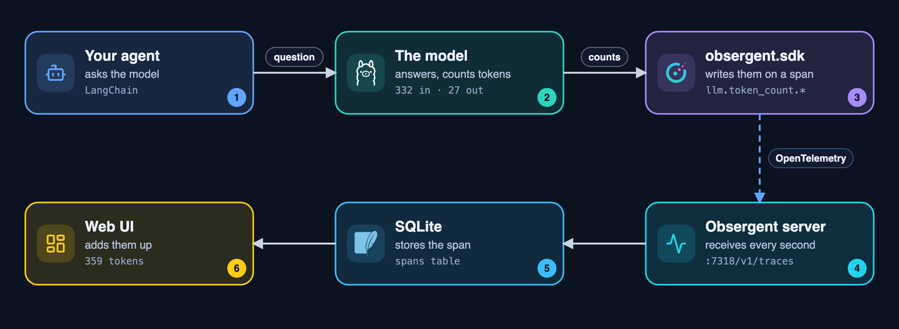

# How Obsergent calculates what a model call costs

**An estimate, never a bill.** It is the recorded number of tokens times the model's price per token. The price comes
from public price lists that Obsergent downloads and re-checks by itself. Nothing is typed in by hand.

## What costs money, and what does not

| Thing                                                                        | Cost                                                                                                                                                                                                                                       |
| ---------------------------------------------------------------------------- | ------------------------------------------------------------------------------------------------------------------------------------------------------------------------------------------------------------------------------------------ |
| A model call (hosted: OpenAI, Anthropic, Groq, OpenRouter, Hugging Face ...) | **yes**: tokens in and out, cheaper for cached tokens                                                                                                                                                                                |
| A model on your own computer (Ollama, LM Studio, vLLM)                       | **$0 per call**, shown as "free". (Electricity and hardware are not counted.)                                                                                                                                                        |
| An MCP call itself                                                           | none: MCP is an open protocol. A hosted, commercial MCP server may charge per call, but no price list exists for that, so it is not counted                                                                                                |
| The WSO2 gateway                                                             | none from Obsergent's point of view: it is open source; you pay for the machine it runs on                                                                                                                                                 |
| Tools' hidden cost                                                           | **yes, and often the biggest part**: every model call carries all tool descriptions in its prompt, and every tool result is fed back to the model. The **By tool** view shows what the model spent deciding to use each tool |

## Exact costs: when the provider tells us

A provider that reports the charge with each response makes an estimate unnecessary. Checked in the official documentation:

| Provider                                                                                                                                                                                                                                                                                                                                                           | Cost in the response?                          | Field                                                                                                                |
| ------------------------------------------------------------------------------------------------------------------------------------------------------------------------------------------------------------------------------------------------------------------------------------------------------------------------------------------------------------------ | ---------------------------------------------- | -------------------------------------------------------------------------------------------------------------------- |
| [OpenRouter](https://openrouter.ai/docs/guides/guides/usage-accounting)                                                                                                                                                                                                                                                                                             | **yes**, always                          | `usage.cost` (credits, 1 credit = $1), `usage.cost_details.upstream_inference_cost`, `usage.is_byok`           |
| [xAI](https://docs.x.ai/developers/cost-tracking)                                                                                                                                                                                                                                                                                                                   | **yes**, includes server-side tool costs | `usage.cost_in_usd_ticks` (divide by 10^10)                                                                        |
| [OpenAI](https://developers.openai.com/api/reference/python/resources/chat/subresources/completions/methods/create)                                                                                                                                                                                                                                                 | no                                             | tokens, cached/reasoning counts, `service_tier`                                                                    |
| [Anthropic](https://platform.claude.com/docs/en/api/messages)                                                                                                                                                                                                                                                                                                       | no                                             | tokens, cache counts, `server_tool_use.web_search_requests`, `service_tier`, `inference_geo`                   |
| [Gemini](https://ai.google.dev/api/generate-content)                                                                                                                                                                                                                                                                                                                | no                                             | `promptTokenCount`, `cachedContentTokenCount`, `candidatesTokenCount`, `thoughtsTokenCount`, `serviceTier` |
| [Groq](https://console.groq.com/docs/api-reference), [Together](https://docs.together.ai/reference/chat-completions-1), [Fireworks](https://docs.fireworks.ai/api-reference/post-chatcompletions), [DeepSeek](https://api-docs.deepseek.com/api/create-chat-completion), [Bedrock](https://docs.aws.amazon.com/bedrock/latest/APIReference/API_runtime_TokenUsage.html) | no                                             | tokens (and cache counts) only                                                                                       |
| [Cohere](https://docs.cohere.com/reference/chat)                                                                                                                                                                                                                                                                                                                    | no                                             | `billed_units` (what is billed) next to `tokens`                                                                 |
| Mistral, Azure OpenAI, Perplexity                                                                                                                                                                                                                                                                                                                                  | not confirmed                                  |                                                                                                                      |

How it gets here: LangChain's OpenAI client keeps the whole `usage` dictionary (the OpenAI SDK keeps unknown fields such as `cost`),
the OpenInference tracer records the model result as the span's `output.value`, and `ingest/billed.py` reads the charge out of it
when the span arrives. It recognises the provider by the SHAPE of the usage (the span says "openai" for OpenRouter and xAI too),
and stores it as `llm.cost.total`. **Streaming:** the charge is only in the last chunk; a call whose recorded response lacks it
falls back to the estimate. `pricing.exact_from_provider: false` shows estimates for everything.
OpenRouter **bring-your-own-key** calls also record what your own provider charged (`obsergent.cost.upstream_usd`).

## Where prices come from (for everything that is estimated)

There is **no official, real-time price feed**: providers publish prices on web pages, and their `/v1/models` endpoints need a key.
So Obsergent reads four public lists (plain GET requests, no key, nothing of yours is sent):

| List                                                                        | Address                                                                                         | Covers                                                                                                             | Unit                 |
| --------------------------------------------------------------------------- | ----------------------------------------------------------------------------------------------- | ------------------------------------------------------------------------------------------------------------------ | -------------------- |
| [models.dev](https://github.com/sst/models.dev) (open source)                | `https://models.dev/api.json`                                                                 | 232 providers, about 9,000 models; cache, reasoning and audio prices                                               | $ per million tokens |
| OpenRouter                                                                  | `https://openrouter.ai/api/v1/models`                                                         | the models OpenRouter serves (live)                                                                                | $ per token          |
| Hugging Face router                                                         | `https://router.huggingface.co/v1/models`                                                     | the models served through Hugging Face (live), per provider                                                        | $ per million tokens |
| [LiteLLM cost map](https://docs.litellm.ai/docs/proxy/custom_model_cost_map) | `https://raw.githubusercontent.com/BerriAI/litellm/main/model_prices_and_context_window.json` | about 4,200 entries; **also** batch/flex/priority prices, long-prompt tiers, 1-hour cache price, search fees | $ per token          |

(LiteLLM is an open-source library and AI gateway; Obsergent does **not** run it, it only reads that one public JSON file.)

## When prices update, and how real-time it is

* **Exact costs are real time:** they arrive with the call.
* **Estimated costs follow the lists:** OpenRouter and Hugging Face publish live and are checked **every 30 minutes**; models.dev and
  LiteLLM are edited by people several times a day and are checked **every 2 hours** (`pricing.refresh_minutes` in `config.yaml`).
  A check sends the stored ETag, so an unchanged list answers "304 Not Modified" (a few hundred bytes). Checks happen while
  Obsergent runs, once at start-up, once more (at most hourly) when a call arrives for a model with no price, and on **Check now**
  (`make prices`). If a download fails, the last prices stay and the **Usage & cost** page (Dollars) says so.
* **Worst case lag** = the list's own update delay + our interval. A call made between a provider's change and our next check uses
  the old price; the price history records when Obsergent first saw each price.
* **Costs on screen** are recalculated every time they are shown; the pages update within about a second when new data arrives
  (see [How often the data refreshes](#how-often-the-data-refreshes)). A banner on the **Usage & cost** page (Dollars) lists price
  changes of the last two weeks.

## Which price is used (estimates)

1. **A call through a router** (OpenRouter, Hugging Face) uses that router's own live list.
2. Otherwise **models.dev's entry for that provider**; columns it lacks (service tiers, 1-hour cache write, search fee) are filled in from
   LiteLLM's entry for the same model; the LiteLLM entry alone if models.dev has none.
3. A provider on your own machine (`pricing.local_providers`) is **free**, even if a hosted model has the same name.
4. No price anywhere: **"no price"**, left out of totals and counted (never silently $0).
5. `pricing.overrides` in `config.yaml` (empty by default) beats everything.

The mark next to an estimate: **✓** two or more lists agree, **≈** they disagree a little (hover for the range), nothing: one list only.
`make price MODEL=<model> PROVIDER=<provider>` prints the price and the mark.

## The formula (estimates)

Prices are dollars per million tokens. Everything below stacks, as the providers' own pages say:

```
1. rates  = the model's price
            service tier (batch / flex / priority, from the response) replaces them when the list has it; batch and flex default to
            half price when it does not (the documented discount of OpenAI, Anthropic and Google)
2. rates  = the long-prompt tier whose size is below the prompt (100k, 128k, 200k, 272k ... whatever the list has)
3. uncached input = prompt - cache reads - cache writes - audio in
   cost = uncached input x input price
        + cache reads x cache-read price
        + 5-minute cache writes x write price + 1-hour cache writes x 1-hour price (Anthropic: 2x input)
        + audio in x audio-in price + audio out x audio-out price
        + (output - reasoning - audio out) x output price + reasoning x reasoning price (the output price if none is listed)
        + web searches x search fee (Anthropic: $10 per 1,000)
4. x 1.1 on the token cost for US-only inference (Anthropic 4.6 and later)
5. an exact cost reported by the provider replaces all of it
```

What the recorded numbers mean (verified): OpenAI reports `input_tokens` *including* cached ones (`ordinary = input - cached - writes`);
Anthropic's raw API reports it *without* them (`total = input + cache_creation + cache_read`), and the OpenInference tracer adds them so
the recorded prompt always includes cached tokens; Gemini bills thinking tokens at the output price and reports them next to the candidate
tokens (added when the recorded completion lacks them); Cohere bills on `billed_units`; DeepSeek's cache hits come as `prompt_cache_hit_tokens`.

**Not covered** (stated in the interface too): Anthropic Priority Tier commitments, fast mode, Bedrock/Vertex regional prices, batch
APIs used outside the recorded response, discounts, taxes, free tiers, other currencies, cache storage fees, local electricity.
**Not yet verified against a real bill:** OpenAI, Anthropic, Gemini and OpenRouter calls (the formula is checked against the providers'
published rules and documented examples).

## Old calls and changed prices

Nothing is frozen except the provider's own charge: every estimate is calculated when shown, from the recorded tokens and the price
table, so a refreshed price changes the numbers at once. The price table keeps a history (a new row only when a price changes) and by
default each call is priced with the price **valid when it was made**. `pricing.reprice: now` (or `?reprice=now`) uses today's prices.
A call older than the first price Obsergent saw for that model uses the oldest known price.

## Turning it off

* `pricing.auto_refresh: false`: nothing is downloaded (costs use the last downloaded prices and overrides): no outbound call.
* `pricing.exact_from_provider: false`: always show estimates.
* `pricing.enabled: false`: no costs at all.

## Tokens: what they are and how Obsergent collects them

### What a token is

A model does not read words or letters: it reads **tokens**, small pieces of text from its own vocabulary (a short word, part of a
longer word, a space, a punctuation mark). In English one token is about ¾ of a word, or about 4 characters. Every provider bills
by tokens, and every model has a limit on how many it can read at once (its "context window").

### Tokens in and tokens out

|               | **Tokens in** (input, "prompt")                                                                                                                    | **Tokens out** (output, "completion")                                                       |
| ------------- | -------------------------------------------------------------------------------------------------------------------------------------------------------- | ------------------------------------------------------------------------------------------------- |
| What it is    | everything the model **reads** for one call                                                                                                        | everything the model **writes** in that call                                                |
| What is in it | the instructions (system prompt), your question, the conversation so far, the results of the tools it used, and the descriptions of the tools it may use | its answer, and its requests to use a tool ("call search_books with query=Python")                |
| How big       | usually most of the tokens, and it **grows with every step**: each model call re-reads the whole conversation                                      | usually small                                                                                     |
| Price         | the cheaper kind (e.g. gpt-4o-mini: $0.15 per million)                                                                                                   | 3–5 times dearer per token (gpt-4o-mini: $0.60 per million)                                      |
| Time          | read quickly                                                                                                                                             | written one token at a time, so it decides how long you wait                                      |
| Cached        | part of the input can come from the provider's cache (repeated beginning of a prompt), billed much cheaper                                               | -                                                                                                 |
| Reasoning     | -                                                                                                                                                        | "thinking" models write hidden reasoning tokens; they are part of the output and billed as output |

**Which one matters most?**

* **Total tokens per question** (in + out) is the headline: how much work one question costs. It is the height of the peaks on the
  Overview and on Usage & cost, and the number on every question card.
* **Tokens in** is where tokens can usually be saved: long instructions, long tool results and many tool descriptions are re-read on
  every step (the Usage page shows the "hidden overhead" of the tool descriptions). It is also what hits the model's context limit
  (Usage & cost warns at 80 %).
* **Tokens out** matters for the bill (dearer per token) and for speed (written one by one); watch it when answers are long.

### How the number of tokens is calculated

**Obsergent does not count tokens itself.** The model provider counts them with the model's own tokenizer while it answers, and
sends the counts back with every response. Obsergent records exactly those numbers, so they match the provider's bill. The names
differ per provider; LangChain turns them all into one shape (`usage_metadata`):

| Provider                              | What its response contains                                                                                                                       | Becomes (LangChain `usage_metadata`) |
| ------------------------------------- | ------------------------------------------------------------------------------------------------------------------------------------------------ | -------------------------------------- |
| Ollama (your setup)                   | `prompt_eval_count`, `eval_count`                                                                                                            | `input_tokens`, `output_tokens`    |
| OpenAI, OpenRouter, Groq, Together... | `usage.prompt_tokens`, `usage.completion_tokens` (+ `prompt_tokens_details.cached_tokens`, `completion_tokens_details.reasoning_tokens`) | the same                               |
| Anthropic                             | `usage.input_tokens`, `usage.output_tokens`, `cache_read_input_tokens`, `cache_creation_input_tokens`                                    | the same                               |
| Google Gemini                         | `usage_metadata.prompt_token_count`, `candidates_token_count`, `thoughts_token_count`                                                      | the same                               |

The **only estimates** are marked "≈" in the UI: in a question's thread, your own message and each tool result have no count of
their own (they are part of the *next* model call's input), so their size is estimated as characters ÷ 4. The same rule estimates
the "hidden overhead" of the tool descriptions. Totals never use estimates: they add up the provider's numbers only.

### Where the tokens come from



1. **Your agent asks the model.** The example agent (`examples/bookshop/agent.py`) uses LangChain's `ChatOllama`; any LangChain
   chat model works, and `obsergent.sdk.init(instrument=["openai"])` / `["anthropic"]` covers code that calls those SDKs directly.
2. **The provider answers with the counts.** A real answer from your Ollama `qwen2.5:7b`:
   `prompt_eval_count: 332, eval_count: 27`. LangChain stores them as
   `usage_metadata: {input_tokens: 332, output_tokens: 27, total_tokens: 359}`.
3. **The recorder writes them on the model call's span.** `obsergent.sdk.init()` turns on the OpenInference LangChain
   instrumentor, which records every model call as a span with
   `llm.token_count.prompt = 332`, `llm.token_count.completion = 27`, `llm.token_count.total = 359`
   (plus `llm.token_count.prompt_details.cache_read` and `llm.token_count.completion_details.reasoning` when the provider reports
   them). On arrival, `ingest/billed.py` adds the facts some providers report in their own words (DeepSeek cache hits,
   Anthropic one-hour cache writes, Cohere billed units).
4. **The span is sent to Obsergent** over OpenTelemetry (OTLP/HTTP, `POST :7318/v1/traces`), in batches **every second**, so a
   question shows up in the UI while the agent is still running.
5. **The server stores it** in SQLite (`~/.obsergent/obsergent.db`, table `spans`, column `attributes`). Nothing is summed when
   it is stored.
6. **Totals are calculated when they are shown**, from the stored spans: per question (`analysis/queries.py: token_sums`), per
   period, model, agent and tool (`analysis/usage.py`), per model (`server/catalog.py`). The cost is `tokens × price` (see
   "The formula" above). The UI asks the server every second whether anything new arrived and reloads at once when it did.

**What is needed:** the agent must call `obsergent.sdk.init()` ("Record your own agent" in the README). The recording **proxy alone** sees only
the MCP tool traffic, not the model calls, so it records no tokens; apps you cannot change (Claude Desktop, Cursor) never send
their model's token counts anywhere, so their tokens cannot be shown.

### A real example (your Ollama, `qwen2.5:7b`)

"What is the cheapest book you have?" took 5 steps and **640 tokens** (568 in + 72 out):

| Step                         | Side | Tokens           | Why                                                                                                    |
| ---------------------------- | ---- | ---------------- | ------------------------------------------------------------------------------------------------------ |
| your question                | 🧑   | ≈ 9             | estimated from its length; it is part of the next call's input                                         |
| model call 1                 | 🤖   | 236 in · 45 out | read the instructions, the tool descriptions and the question; wrote a request to use `search_books` |
| tool `search_books`        | 🔧   | ≈ 1             | its (empty) result is added to the next call's input                                                   |
| tool `get_price_and_stock` | 🔧   | ≈ 12            | its result is added to the next call's input                                                           |
| model call 2 (answer)        | 🤖   | 332 in · 27 out | re-read **everything** above (that is why the input grew from 236 to 332) and wrote the answer   |

The total is the sum of the model calls only: (236 + 332) in + (45 + 27) out = 640. On Ollama this costs $0 (it runs on your
computer); the same tokens on gpt-4o-mini would cost 568 × $0.15/1M + 72 × $0.60/1M ≈ $0.00013.

### Where to watch them

* **Overview:** the Tokens tile (and the change from the period before); the peaks chart switched to Tokens.
* **Usage & cost → Tokens:** a peak per question as high as its tokens, where the tokens went (model, agent, tool, heaviest
  questions), the hidden overhead, prompts near the model's limit, heavy questions, the daily budget.
* **Conversations:** the tokens of each step.
* **Models:** the tokens of each model and their trend.
* **Terminal:** `make usage` (`make usage HOURS=168` for a week).
* **Budget:** `usage.daily_token_budget` in `config.yaml` (or `OBSERGENT_TOKEN_BUDGET`) warns from `usage.warn_at_percent`
  (80 %); questions far above your usual are flagged in Things to check.

## How often the data refreshes

* **Agent and proxy send data:** every 1 second, plus straight away when the agent exits.
* **Browser checks "anything new?"** (`GET /api/version`): every 1 second, paused while the tab is in the background.
* **Page data re-fetch when something new arrived:** straight away, within about 1 second of new data.
* **Page data re-fetch as a safety net:** every 15 seconds normally, or every 2 seconds with **Live** on.
* **Coming back to the browser tab:** re-fetches straight away.
* **Server "connected" light** (`/health`): every 10 seconds.
* **Things to check badge in the menu:** with the page data (every 15 s, or 2 s with Live), and straight away when something new arrives.
* **Price lists download:**
  * OpenRouter and Hugging Face: every 30 minutes.
  * models.dev and LiteLLM: every 2 hours.
  * A model with no known price triggers an extra download, at most once an hour.
  * The **Check now** button downloads them straight away.
