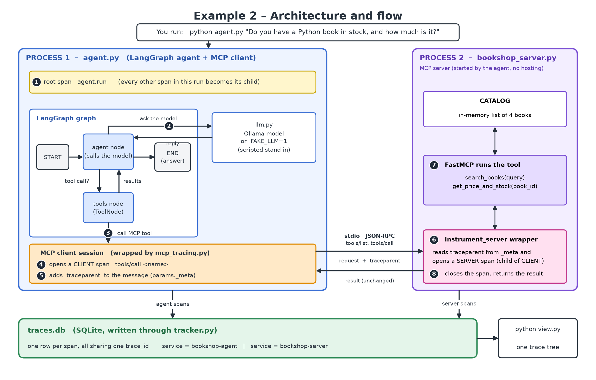

# Example 2: MCP server, client and a LangGraph agent (with MCP tracing)

A custom MCP server with two tools, and a LangGraph agent that is also the MCP
client. On top of the plan's code, this folder adds **MCP client and server
tracing** so you can see both sides of every MCP request in one trace.

## Files

| File                        | Purpose                                                                   |
| --------------------------- | ------------------------------------------------------------------------- |
| `bookshop_server.py`      | MCP server with`search_books` and `get_price_and_stock`               |
| `llm.py`                  | Ollama model, or`FAKE_LLM=1` scripted stand-in                          |
| `agent.py`                | LangGraph agent = MCP client; opens the root`agent.run` span            |
| `mcp_tracing.py`          | **Added:** client + server MCP spans, trace ID passed via `_meta` |
| `tracker.py`, `view.py` | Copied from Example 1 (spans -> SQLite, print as tree)                    |

## Architecture and flow

Two processes: the **agent** (LangGraph + MCP client) and the **server**
(Bookshop). Both write their spans into the same `traces.db`.



The loop ② → ③ → ④–⑧ → back to ② repeats until the model answers without asking for a tool. With
`FAKE_LLM=1` that is two rounds: `search_books`, then `get_price_and_stock`.

| Step  | What happens                                                           | Code                                        |
| ----- | ---------------------------------------------------------------------- | ------------------------------------------- |
| ①    | Root span`agent.run` opens                                           | `agent.py` `main()`                     |
| ②    | The`agent` node sends the conversation to the model                  | `agent.py` `call_model`, `llm.py`     |
| ③    | The model asked for a tool, so the`tools` node calls the MCP session | `ToolNode`                                |
| ④ ⑤ | CLIENT span opens; trace ID goes into`params._meta`                  | `mcp_tracing.py` `trace_client_session` |
| ⑥    | Server reads the trace ID and opens a child SERVER span                | `mcp_tracing.py` `instrument_server`    |
| ⑦ ⑧ | Tool runs, result returns, both spans close and are saved              | `bookshop_server.py`, `tracker.py`      |

## Why `mcp_tracing.py` exists

MCP Python SDK **v2** creates OpenTelemetry spans by itself. But
`langchain-mcp-adapters` needs SDK **v1** (`mcp<2`), which has no tracing, so
v2 can't be installed here. `mcp_tracing.py` does by hand what v2 does:

- **Client:** `trace_client_session(session)` wraps `call_tool` / `list_tools`,
  creates a CLIENT span per request and injects the W3C `traceparent` into `params._meta`.
- **Server:** `instrument_server(mcp)` wraps the `tools/call` and `tools/list`
  handlers, reads `traceparent` from `_meta` and creates a SERVER span under it.

## Run it

From the repository root, with the virtual environment active and requirements installed
(`uv pip install -r requirements.txt`, with the Example 2 lines uncommented):

```bash
cd tutorial/example2_mcp_langgraph_agent
```

**Without Ollama** (scripted stand-in model):

```bash
FAKE_LLM=1 python agent.py
python view.py
```

**With Ollama:**

```bash
ollama pull qwen2.5:7b                 # 16 GB RAM or more
# ollama pull llama3.2:3b              # 8 GB RAM, then: export OLLAMA_MODEL=llama3.2:3b
python agent.py "Do you have a Python book in stock, and how much is it?"
python view.py
```

Expected answer: `Book b1 costs $39.99 and there are 4 copies in stock.`

Expected `view.py` output (timings vary):

```
Trace 62bf3eec88c8...  (7 spans)
  - agent.run  (bookshop-agent, 243.7 ms)
    - tools/list  (bookshop-agent, 1.8 ms)  mcp.method.name=tools/list
      - tools/list  (bookshop-server, 0.0 ms)  mcp.method.name=tools/list
    - tools/call search_books  (bookshop-agent, 1.9 ms)  gen_ai.tool.name=search_books
      - tools/call search_books  (bookshop-server, 0.4 ms)  gen_ai.tool.name=search_books
    - tools/call get_price_and_stock  (bookshop-agent, 1.5 ms)  gen_ai.tool.name=get_price_and_stock
      - tools/call get_price_and_stock  (bookshop-server, 0.3 ms)  gen_ai.tool.name=get_price_and_stock
```

Each tool call appears twice: the `bookshop-agent` span is the client side, the
`bookshop-server` span below it is the server side. Both are in one trace
because they share the trace ID. Arguments and results are stored as span
attributes (`mcp.tool.arguments`, `mcp.tool.result`):

```bash
sqlite3 traces.db "SELECT service, name, attributes FROM spans WHERE name LIKE 'tools/call%'"
```

Run the server alone (it waits on stdin/stdout): `python bookshop_server.py`.
Turn tracing off with `MCP_TRACING=0`. Delete `traces.db` to start fresh.

## Try this

- Ask about a book that doesn't exist and find the `error` in the stored result.
- Compare the client and server durations of one call: the gap is transport time.
- Run `python view.py` after several runs and notice each run is its own trace.
