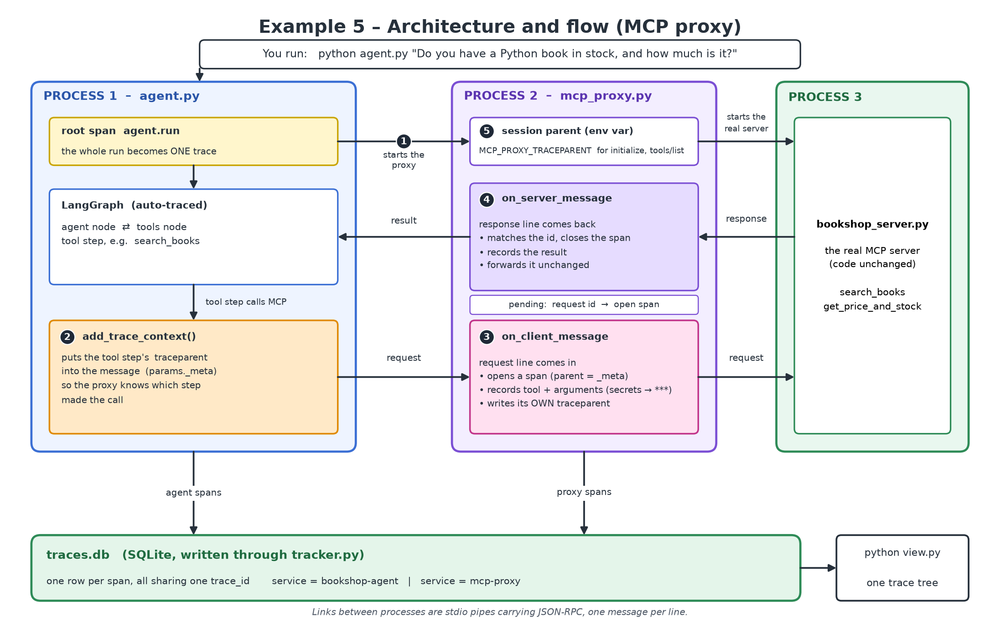

# Example 5: an MCP proxy with OpenTelemetry

Goal: record **every MCP message** between any client and any server, and join
those spans to the agent's trace. This is Obsergent's key component.

Example 4 showed the inside of the agent but not the MCP traffic. The proxy
fills that gap: it sits between client and server and works for any stdio MCP
server (Python, Node, Go...) without changing its code.

## Files

| File                               | Purpose                                                                           |
| ---------------------------------- | --------------------------------------------------------------------------------- |
| `mcp_proxy.py`                   | **The proxy.** Copies JSON-RPC lines both ways; each request becomes a span |
| `trace_context.py`               | Passes the agent's trace ID to the proxy (needed because MCP SDK v1 doesn't)      |
| `agent.py`                       | Example 4's agent, but it starts the server*through* the proxy                  |
| `tracker.py`, `view.py`        | Copied from Example 1 (spans -> SQLite, print as tree)                            |
| `bookshop_server.py`, `llm.py` | Same server and model as before                                                   |

## Architecture and flow



How one request travels (the numbers match the diagram):

1. The agent starts `python mcp_proxy.py -- python bookshop_server.py` instead of the server. The proxy starts the real server itself.
2. The tool step calls the MCP session. `add_trace_context` adds `traceparent` (the tool step's "ticket number") to `params._meta`.
3. The proxy reads that line, opens a span as a child of the tool step, records the tool name and arguments, rewrites `traceparent` to its own span, and forwards the line.
4. The server answers. The proxy matches the response `id` to the request, records the result, closes the span and forwards the answer **unchanged**.
5. Messages with no `_meta` (`initialize`, `tools/list`) use the session parent from the `MCP_PROXY_TRACEPARENT` environment variable.

Safety: keys that look secret (`password`, `token`, `api_key`, `secret`,
`authorization`) are stored as `***`; long values are truncated.

## Run it

From the repository root, with the virtual environment active and requirements installed
(`uv pip install -r requirements.txt`):

```bash
cd tutorial/example5_mcp_proxy
FAKE_LLM=1 python agent.py       # without Ollama; use plain `python agent.py` with Ollama
python view.py
```

Expected `view.py` output: 19 spans from two services (timings vary):

```
Trace 8f19fc4a045d...  (19 spans)
  - agent.run  (bookshop-agent, 675.5 ms)
    - initialize  (mcp-proxy, 476.0 ms)  mcp.method.name=initialize
    - tools/list  (mcp-proxy, 2.2 ms)  mcp.method.name=tools/list
    - LangGraph  (bookshop-agent, 59.2 ms)
      - agent  (bookshop-agent, 8.0 ms)
        - ScriptedFakeLLM  (bookshop-agent, 1.7 ms)
        - tools_condition  (bookshop-agent, 0.8 ms)
      - tools  (bookshop-agent, 14.4 ms)
        - search_books  (bookshop-agent, 11.6 ms)
          - tools/call search_books  (mcp-proxy, 6.5 ms)  gen_ai.tool.name=search_books
      ...
      - tools  (bookshop-agent, 10.2 ms)
        - get_price_and_stock  (bookshop-agent, 7.2 ms)
          - tools/call get_price_and_stock  (mcp-proxy, 2.7 ms)  gen_ai.tool.name=get_price_and_stock
```

The `mcp-proxy` spans sit under the exact tool step that made each call, and
`initialize` and `tools/list` are now visible. See the arguments and results the
proxy recorded:

```bash
sqlite3 traces.db "SELECT name, json_extract(attributes,'\$.\"mcp.tool.arguments\"') AS args,
  substr(json_extract(attributes,'\$.\"mcp.result\"'),1,80) AS result
  FROM spans WHERE service='mcp-proxy' AND name LIKE 'tools/call%'"
```

## Try the proxy on its own (like a closed app would)

Apps you can't change (Claude Desktop, Cursor) send no `traceparent`, so every
request starts its own trace. To see this, point such an app's MCP config at the proxy:

```json
{
  "mcpServers": {
    "bookshop": {
      "command": "/FULL/PATH/TO/.venv/bin/python",
      "args": ["/FULL/PATH/TO/mcp_proxy.py", "--", "/FULL/PATH/TO/.venv/bin/python", "/FULL/PATH/TO/bookshop_server.py"],
      "env": { "TRACKER_DB": "/FULL/PATH/TO/traces.db" }
    }
  }
}
```

Any other stdio server works the same way, for example
`python mcp_proxy.py -- npx -y @modelcontextprotocol/server-filesystem /tmp`.

## Lesson learned

The first version used the generic variable name `TRACEPARENT`. Another tool had
already set it (marked "not sampled"), so the proxy silently recorded nothing.
Hence the dedicated name `MCP_PROXY_TRACEPARENT`, and an empty context when it is
missing.

## Try this

- Add `"api_key": "abc"` to a tool call's arguments and check it is stored as `***`.
- Run `python mcp_proxy.py -- python bookshop_server.py` by hand and paste a JSON-RPC line to see it wait on stdin.
- Compare this tree with Example 2's, where the tracing was inside the client and server code.
